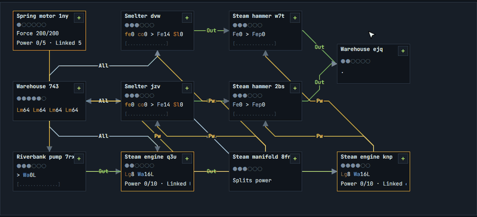
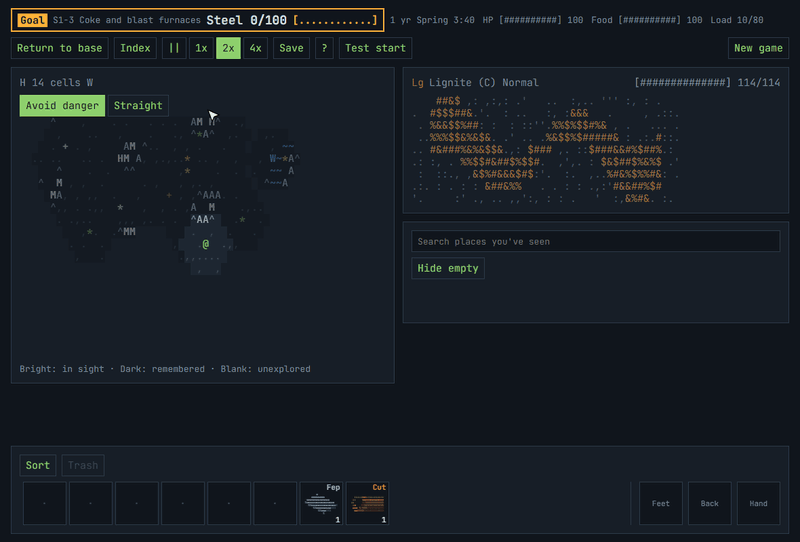

# Manifold

[English](README.md) · **한국어**

**[▶ 브라우저에서 플레이하기](https://phy-ce.github.io/Manifold/)**: 설치가 필요 없고, 한국어와 영어를 지원합니다.

기술모드팩에서 공정을 설계하는 재미만 남긴 글자 기반 공장 게임입니다. 돌아다니고 노가다하는 시간을 줄이고, 노드 그래프에서 생산 라인을 짜는 데 집중합니다.



## 게임 소개

광맥을 찾아 캐고, 기계를 만들어 기지의 보드에 놓고, 선으로 이어 공정을 만듭니다. 처음에는 손으로 망치질하고 태엽을 감지만, 증기기관을 세우면 공장이 스스로 돌아가기 시작합니다.



- **공정 설계:** 노드 하나가 기계 한 대이고, 포트는 6개입니다. 재료, 동력, 부산물을 어떻게 잇느냐가 게임입니다.
- **동력:** 태엽은 힘을 저장하고, 증기기관은 출력 한도 안에서 기계에 나눠 줍니다. 한도를 넘으면 전부 느려집니다. 선으로 물건을 옮길 때도 동력을 씁니다.
- **액체:** 물과 콜타르는 손으로 못 옮깁니다. 선으로 흘리거나 드럼통에 담아야 합니다.
- **탐색:** 지도는 끝이 없고 시드로 생성됩니다. 광맥은 빈약, 보통, 풍부 등급이 있습니다.
- **생존:** 체력과 허기, 계절이 있습니다. 강과 산은 위험하고, 쓰러지면 들고 있던 재료를 잃습니다.
- **노드 편집기:** 찾기, 선 종류 강조, 복사와 붙여넣기, 청사진, 묶기, 확대/축소를 지원합니다.

조작법은 게임에서 `?` 키를 누르면 볼 수 있습니다.

## 진행 상황

`S`는 시대이고, 뒤의 숫자는 그 시대의 단계입니다.

| 단계 | 내용 | 목표 | 상태 |
|---|---|---|---|
| S1-1 | 증기기관 + 구리 배관 | 증기기관 1개 | 플레이 가능 |
| S1-2 | 증기 동력 보급 | 철판 120개 | 플레이 가능 |
| S1-3 | 코크스와 고로 | 강철 100개 | 플레이 가능 |
| S1-4 | 증기 공작기계 | 포트 증설 플랜지 6개 | 설계만 있음 |
| S1-5 | 증기 발전기 | 증기 발전기 3개 | 설계만 있음 |
| S2 | 전자시대 | | 예정 |

## 개발

Node.js 22가 필요합니다.

```sh
npm install
npm run dev
```

| 명령어 | 내용 |
|---|---|
| `npm run dev` | 개발 서버 실행 |
| `npm run build` | 타입 검사와 빌드 |
| `npm test` | 게임 규칙과 번역 테스트 |
| `npm run check:data` | 레시피 데이터 검사 |

`main`에 push하면 GitHub Actions가 데이터 검사, 테스트, 빌드를 거쳐 GitHub Pages에 배포합니다.

TypeScript와 Vite를 쓰고, 기계 그림은 PixiJS로 그립니다. 게임 규칙은 화면 코드와 분리되어 있어서 브라우저 없이 테스트할 수 있습니다.

| 경로 | 내용 |
|---|---|
| `data/` | 재료, 기계, 레시피, 광석 데이터 |
| `src/engine/` | 게임 규칙. 화면과 분리됨 |
| `src/ui/` | 화면 |
| `src/ui/theme.ts` | 크기 기준값 |
| `src/i18n.ts` | 언어와 영어 번역 |
| `DESIGN.md` | 전체 설계 기준과 문서 목록 |
| `docs/design/` | 세부 설계 문서 |

레시피는 실제 산업 공정을 바탕으로 직접 설계했습니다.

## 라이선스

MIT
