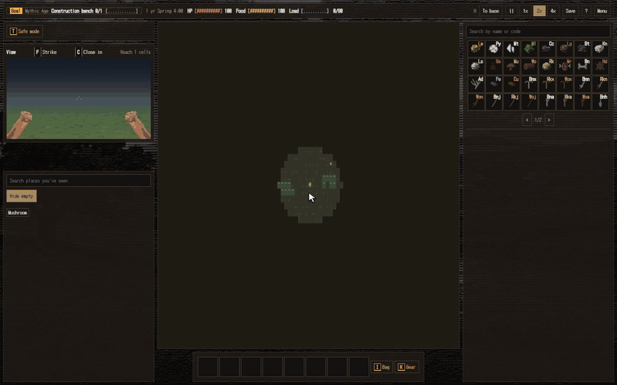

# Manifold

**English** · [한국어](README.ko.md)

**[▶ Play in your browser](https://phy-ce.github.io/Manifold/)**: nothing to install, in English and Korean.

A text-art factory game inspired by Minecraft tech modpacks.



## How it plays

Find veins on the map and mine them, build machines, place them on your base board and link them with lines. At first you hammer plates and wind springs by hand. Once a steam engine is up, the factory starts running on its own.

- **Production design:** each node is one machine with six ports. The game is how you wire materials, power and by-products.
- **Power:** springs store force, and steam engines share their output among machines up to a limit. Go past it and everything slows down together. Moving items along a line also uses power.
- **Liquids:** water and coal tar can't be carried by hand. Pipe them through lines or fill drums.
- **Exploration:** the map is endless and generated from a seed. Veins come in scarce, normal and rich grades.
- **Survival:** health, hunger and seasons. Rivers and mountains are dangerous, and if you collapse you lose what you were carrying.
- **Node editor:** search, line-type highlighting, copy and paste, blueprints, grouping and zoom.

Press `?` in the game to see the controls.

## Progress

`S` is the era, and the number after it is the stage within that era.

| Stage | Content | Goal | Status |
|---|---|---|---|
| S1-1 | Steam engine and copper piping | 1 steam engine | Playable |
| S1-2 | Steam power | 120 iron plates | Playable |
| S1-3 | Coke and blast furnaces | 100 steel | Playable |
| S1-4 | Steam machine tools | 6 port flanges | Designed only |
| S1-5 | Steam generator | 3 steam generators | Designed only |
| S2 | Electric era | | Planned |

## Development

Requires Node.js 22.

```sh
npm install
npm run dev
```

| Command | What it does |
|---|---|
| `npm run dev` | Start the dev server |
| `npm run build` | Type-check and build |
| `npm test` | Game rule and translation tests |
| `npm run check:data` | Validate recipe data |

Every push to `main` runs the data check, tests and build in GitHub Actions, then deploys to GitHub Pages.

Built with TypeScript and Vite. Machine art is drawn with PixiJS. The game rules are kept apart from the UI code, so they can be tested without a browser.

| Path | Contents |
|---|---|
| `data/` | Materials, machines, recipes and ores |
| `src/engine/` | Game rules, separate from the UI |
| `src/ui/` | UI |
| `src/ui/theme.ts` | Size units |
| `src/i18n.ts` | Languages and English translation |
| `DESIGN.md` | Overall design rules and list of documents (Korean) |
| `docs/design/` | Detailed design documents (Korean) |

The recipes are designed by hand, based on real industrial processes.

## License

[GNU GPL v3](LICENSE) or later. You may copy, change and share it, but anything you distribute that is based on it must also be released under the GPL with its source code, keeping the [NOTICE](NOTICE). Versions published before this change were released under Apache 2.0, and earlier ones under MIT.
